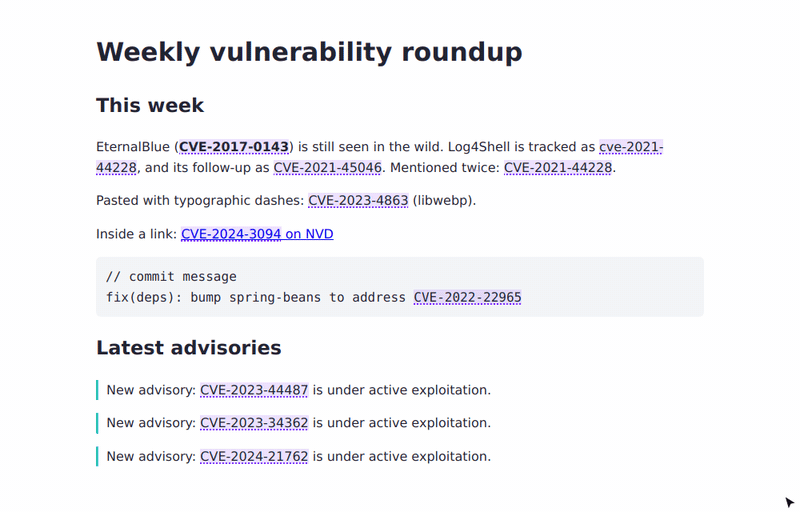
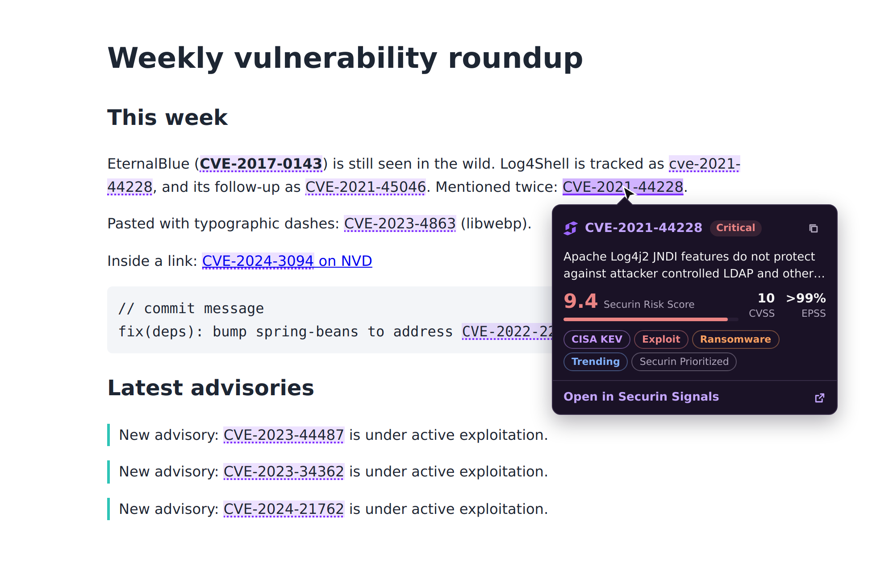
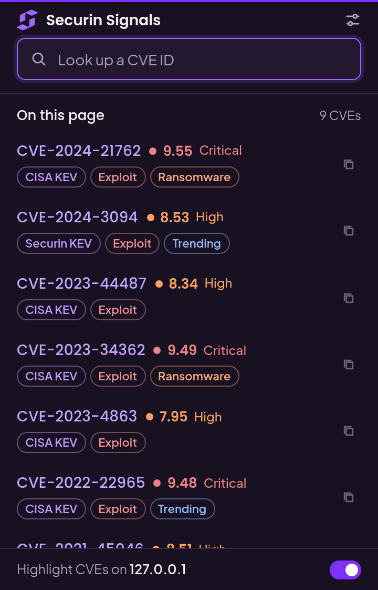
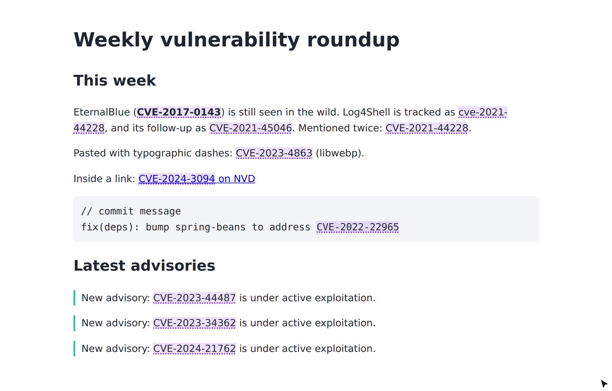

<div align="center">


# Securin Signals for Chrome

**Risk context for every CVE on the web, one hover away.**

[Website](https://www.securin.io/) · [Vulnerability Database](https://www.securin.io/vulnerability-database/)

[](https://www.securin.io/)




</div>

---

Securin Signals for Chrome finds CVE identifiers on any webpage and gives you Securin's vulnerability
intelligence right where you read them: on advisories, tickets, pentest reports, chat threads and news articles.
You don't have to copy the ID, switch tabs and search for it.

## Features

- **Automatic detection.** CVE IDs in page text get a subtle violet underline, including content loaded after the page opens.
- **Hover signals.** Pointing at a CVE shows the Securin Risk Score, CVSS, EPSS, CISA/Securin KEV, exploit, ransomware,
  zero-day, trending and Securin tags.
- **One-click record.** **Open in Securin Signals** opens the full record on
  [securin.io](https://www.securin.io/vulnerability-database/).
- **Page summary popup.** Lists every unique CVE on the page with its risk score and key signals, and includes a quick
  CVE lookup. Shortcut: `Alt+Shift+S`.
- **Right-click actions.** **Open CVE in Securin Signals** and **Copy CVE identifier** on selected text or a highlighted CVE.
- **You stay in control.** Turn highlighting, the hover card, hover signals or the toolbar count on or off, per site or globally.

## Screenshots

<table>
  <tr>
    <td width="62%"></td>
    <td width="38%" rowspan="2"></td>
  </tr>
  <tr>
    <td></td>
  </tr>
  <tr>
    <td align="center"><sub><b>Hover card</b> (top) and <b>automatic highlighting</b> (bottom)</sub></td>
    <td align="center"><sub><b>Popup</b>: every CVE on the page, ranked</sub></td>
  </tr>
</table>

## Getting started

**Requirements:** Node.js 20.19+ (or 22+), npm, Chrome 110+.

```bash
git clone https://github.com/securin-public/securin-signals-extension.git
cd securin-signals-extension
npm install
npm run build
```

Then load it in Chrome:

1. Open `chrome://extensions` and turn on **Developer mode**.
2. Click **Load unpacked** and select the `dist/` folder.
3. Reload any tabs that were already open. Content scripts are injected when a page loads.

To build a Chrome Web Store package, run `npm run package` and upload the resulting `securin-signals.zip`.

## Development

| Command           | Purpose                                                                       |
| ----------------- | ----------------------------------------------------------------------------- |
| `npm run build`   | Typecheck, then build the popup, options, service worker and content script   |
| `npm run dev`     | Rebuild pages and the service worker on change                                |
| `npm run demo`    | Serve a test page with sample CVEs at http://127.0.0.1:5174                   |
| `npm test`        | Run the Vitest unit and component tests                                       |
| `npm run lint`    | ESLint (bans `innerHTML`, `eval` and similar)                                 |
| `npm run check`   | Lint, format check, tests and build                                           |
| `npm run package` | Build and zip `dist/` for the Chrome Web Store                                |
| `npm run icons`   | Regenerate toolbar icons from `src/shared/securin-mark.svg` (requires Chrome) |

### Project structure

```
src/
├── content/     CVE scanning, highlighting (CSS Custom Highlight API), hover card
├── background/  Service worker: message routing, context menus, badge, signal lookups
├── popup/       React toolbar popup
├── options/     React settings page
├── api/         Signal providers, response parser, cache and timeouts
├── shared/      Navigation, Securin theme tokens, brand mark
└── utils/       CVE parsing, URL building, typed messages, settings
tests/           Vitest suites
```

The HTML pages and the ES-module service worker are built by `vite.config.ts`. The content script is built separately
as a single IIFE by `vite.content.config.ts`, because content scripts can't be ES modules.

## How it works

- **No page changes.** Matches are painted with `CSS.highlights`, so the page DOM is never modified. Text owned by
  React or Vue, links and code blocks keep working as before.
- **Efficient scanning.** A pruned `TreeWalker` scans the page, and debounced `MutationObserver` updates rescan only the
  subtrees that changed. Work is capped at 5,000 occurrences per page.
- **Strict matching.** IDs match `CVE-YYYY-NNNN…`, case-insensitively and with typographic dashes normalized.
  Form fields, editable regions, scripts, iframes and the extension's own UI are skipped.

## Permissions

| Permission                                    | Why it's needed                                                               |
| --------------------------------------------- | ----------------------------------------------------------------------------- |
| Content script on `http://*/*`, `https://*/*` | Reads page text locally to detect CVE IDs. Page content is never transmitted. |
| `contextMenus`                                | Adds the right-click **Open** and **Copy** actions.                           |
| `storage`                                     | Stores settings and caches hover signals for the browser session.             |
| `https://d2tc2ta7c5xxs3.cloudfront.net/*`     | Securin's vulnerability-database endpoint used for hover-card signals.        |

The extension does **not** request `tabs`, `activeTab`, `scripting`, `webRequest` or clipboard permissions.

## Security and privacy

- **Minimal network use.** The only request sends the hovered CVE ID to Securin's vulnerability database, with no
  cookies, credentials or referrer. Turning off **Show Securin signals on hover** stops it. There is no analytics, no
  remote code and no remote fonts.
- **Fixed destination.** Record URLs are rebuilt and verified against `https://www.securin.io` before a tab opens.
  Messages carry CVE IDs, never URLs.
- **Validated input.** Every extension message is schema-checked and its sender verified. Webpages can't message the
  extension. API responses are treated as untrusted: they are type-checked, range-checked and size-limited.
- **No unsafe HTML.** The UI is built with React, or with DOM APIs inside a closed shadow root. The default MV3 CSP applies.
- **Bounded traffic.** Lookups are de-duplicated, cached (6 h for records, 1 h for not-found), time out after 8 s and are
  limited to 30 per minute.

See [PRIVACY.md](PRIVACY.md) for the full privacy policy.

## Signals integration

Hover-card signals come from the endpoint www.securin.io itself uses to render CVE pages. Securin has approved its use
by this extension:

```
POST https://d2tc2ta7c5xxs3.cloudfront.net/api/vti-database/search
{"view":"cve","id":"CVE-2017-0143"}  →  200 {"item": {...}}  |  404 {"error":"CVE not found"}
```

The endpoint isn't formally versioned, so the parser treats every field as optional. If the response shape changes,
the hover card shows "Signals are unavailable right now" and **Open in Securin Signals** keeps working, because
navigation never depends on the API. To move to a versioned API, implement a new `CveIntelligenceProvider` and swap it
in `src/background/signals.ts`.

## Testing

`npm test` runs 244 tests covering CVE parsing, URL safety, DOM scanning, message validation, the signals parser
(including hostile payloads), caching and rate limiting, and the popup and options UI. See
[docs/TESTING.md](docs/TESTING.md) for the browser smoke test and the manual QA checklist.

## Known limitations

- A CVE split across elements (for example `CVE-2017-<b>0143</b>`) isn't detected.
- Only the top frame is scanned. CVEs inside iframes and inside web-component shadow DOM aren't detected.
- The hover card uses system fonts. Exposing the bundled fonts to pages would let sites fingerprint the extension.
- The first hover after the service worker starts can take a few seconds.

## Changelog

See [CHANGELOG.md](CHANGELOG.md).

---

<div align="center">
<sub>Built by <a href="https://www.securin.io/">Securin</a>. Proprietary and confidential. All rights reserved.</sub>
</div>
